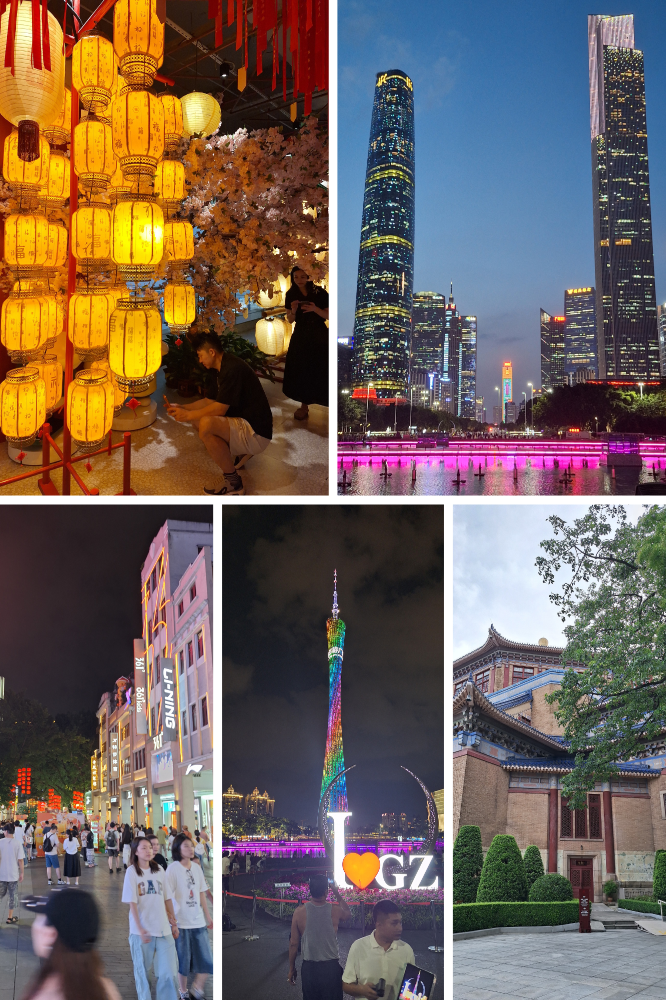

In 2025, I blogged my journey along the coast of Eastern Canada. For one month, I documented my day-to-day experience for each of the seven cities. Now, if it wasn't obvious, “Journey to the East(ern Canada)” was a parody of the famous Chinese Novel Journey to the West. So color me surprised that the following summer allowed me to study in Beijing, China. Of course I had to capitalize on this opportunity, and so begins an incredible three-month backpacking journey across my home country!

Twenty different cities over three months! It's surreal laying it all out on a map:

To stop these blogs from going longer than they already are, I'm keeping my day-long Seoul and Seattle layovers in a separate blog.

Finally, I love walking anywhere I can handle for as long as possible. Combining transit like buses, subways, high-speed rail, ferries, airplanes, and taxis, I found myself able to explore so much with just one backpack and a sling. Below is an abridged collage of the various regions I visited in my first month.

# Coastal Peninsula

After visiting relatives in Dalian, I started my journey with an overnight ferry crossing across the Bohai Strait. A surprisingly unknown and cheap way to cross without having to go around Beijing.

## Yantai

A beautiful coastal town to start with! Beautiful beaches, blue skies, and yummy seafood, Yantai really leans into its coastal aesthetics. Just a stroll along the harbour and white beaches really kicked off the feeling of entering a whole different world. Ending the day with a sunset over the beach:

## Qingdao

The drunk, party-head cousin city to Yantai, Qingdao is known for its lively culture, hybrid of European and Chinese architecture, and host of many major festivals large and small. Home of Qingdao beer, the country's biggest beer festival, host of the Summer Olympics, massive street food culture, and a popular hub for young people looking for a fun time.

And of course, plenty of street food and seafood:

# Shandong 山东

A quick hour-long train ride inland took me to the beautiful environment of Shandong. One of my favorite things about China was the diversity and grandiosity in its natural landscapes. Shandong, literally translated as “Eastern Mountain”, contains some of the most historically important mountains and gardens, which I had to, of course, pay a visit.

## Tai'an and Taishan

Before climbing the holy mountain Taishan, I took a day to explore the town at the base. Visited by 4 different emperors across multiple dynasties, Taishan can be considered the holy site of Confucianism.

The town itself was very cosy, and I found myself enjoying the slower crowds and more personal atmosphere. Confucius temple, street vendors, and night markets.

The next day, though, I went straight to Taishan mountain. Typically a 3-4 hour climb with thousands of visitors per day, I began my ascent before noon and managed the top in under 2 hours. The 6000-7000 steps are lined with ancient temples and stone carvings, accompanied by an incredible view of the whole county from high up.

Historical figures describe the top of Taishan as walking atop heaven itself. Staying overnight let me watch the sunset and sunrise - a pilgrimage akin to walking the Great Wall. Also much cooler up high than down low.

## Jinan 济南

The capital of Shandong province, known for its natural springs and a lively nightlife along the waterside. I decided to stay next to Daming lake (大明湖) for a day before I cross down south. A very pretty stroll after a long hike.

# Guangdong 广东

China’s richest province, stemming from a history as the only port serving foreigners, and home to the Cantonese language and culture. Even dedicating two weeks to just the big cities wasn't enough to explore this economic hub of startups and the biggest corporations. See the stark contrast of historical residential areas, temples, and parks in contrast to some of the wealthiest shopping malls, skyscrapers, and transit.

Going out of my way to take the D901. This is an experimental overnight sleeper train with private beds, like what you may find in Europe. A great way to save on hotel costs and sleep the full route from Beijing to Shenzhen:

## Guangzhou 广州

My first stay was on Beijing Road (北京路), the busiest pedestrian road that comes to life at night. Shopping malls line the street, and a whole underground mall connecting two subway stops contains a massive underground Anime culture.

The historical port and economic center of China, Guangzhou blends its ancient history, foreign influence, and contemporary Chinese culture all in one ginormous city! I particularly loved the museums, old residential districts, and market streets.

Coincidentally I managed to catch the Guangzhou international dragon boat competition. Rushing to find a spot along the lake or river, you can hear the gongs ringing as teams of rowers run laps around the crowds. Race day itself was really busy too, with teams across China, and even the embassy of Canada and the USA, race along the Pearl River.

The next night, I then took the iconic Guangzhou river city cruise along the very same river. Lights line the channel and bridges, and a pass around the rainbow Guangzhou tower. A great way to escape from the sweltering heat.

## Shenzhen 深圳

“The city of the future” is surprisingly different from its sister city only half an hour away. Risen out of the coast from wandering entrepreneurs, designed around green urbanism, and a fairly recent population explosion, sees Shenzhen as a uniquely modern and rich city with a bustling culture. Trees and plants grow inside sleek modern malls and plazas, mixing with the bustling roads and streets filled with business workers and young people all around.

You can even see the island of Hong Kong from the waterfront. One of my favorite walks, especially in the evening when everyone comes out and the city lights up with activity:

### Southern University of Science and Technology

I was invited by SUSTech for their summer event, APEC - the Asian Pacific Economic Conference. Showcasing research and business in AI across various industries, with live tours from major companies like Huawei, Tencent, BYD, etc. A shoutout to all the international talent I met from Canada, Africa, Singapore, and more.

# Hong Kong 香港

Coming from a full month of traveling in the mainland, first time touching down in Hong Kong felt so shocking in language and culture. I just happened to arrive on July 1st, the 29th anniversary of HKSAR, and witnessed the streets packed with flags and celebrations across the city.

Good food is a given, from iconic chains to family-run restaurants. While much more expensive than in Shenzhen, I also enjoyed traditional HK breakfast, dim sum, and hybrid cuisine across all of Asia. Transit here was also different, with Octopus card and cash, while the MTR miraculously kept up with so many commuters! Also, the ferry and trams are very fun to ride but very rickety and not for the weak of stomach.

Victoria Harbour from the Kowloon side:

Only a 20-minute train ride across the channel, I urge anyone traveling in this area to visit Guangzhou, Shenzhen, and Hong Kong in one trip.